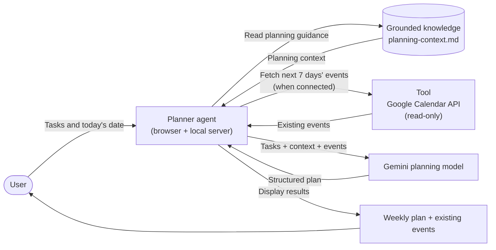

# Outreach Week Planner

A small, local-first weekly planner for student ambassadors. Task lists and plan decisions live only in the open browser page. An optional Google Calendar connection adds read-only events to the plan; its access token lives only in the server's memory and expires with the server process or token.

## Run locally

1. Install Node.js 18 or newer.
2. In this folder, run `npm install`.
3. Copy `.env.example` to `.env` and add your Gemini API key to `GEMINI_API_KEY`.
4. Start the app with `npm start`, then open [http://localhost:3000](http://localhost:3000).

The app uses the Gemini API's OpenAI-compatible Chat Completions endpoint with `gemini-3.8-flash` by default. Change `GEMINI_MODEL` in `.env` to select another compatible Gemini model. The API key is read only by the server and is never sent to the browser. The Gemini free tier has usage limits, and Google may use free-tier data to improve its products; avoid sending sensitive information.

## Architecture

## Personal planning context

Edit [`planning-context.md`](./planning-context.md) in this folder to give the planner background it should use each week. Add concise, lasting details under the headings, such as your responsibilities, usual availability, prioritization rules, workload boundaries, outreach or course requirements, and the tone you prefer for the weekly summary. Remove headings that do not apply.

The server reads this Markdown file whenever you build a week, so changes take effect on the next plan without a restart. Keep it at or under 12 KB. Its contents are sent to Gemini along with your tasks and any connected calendar events when generating a plan; do not include sensitive information.

## Optional: read-only Google Calendar

1. In Google Cloud Console, enable the Google Calendar API and create an OAuth client for a web application.
2. Set the authorized redirect URI to `http://localhost:3000/auth/google/callback`.
3. Add the client ID, client secret, and redirect URI to `.env` as `GOOGLE_CLIENT_ID`, `GOOGLE_CLIENT_SECRET`, and `GOOGLE_REDIRECT_URI`.
4. Restart the server and use **Connect calendar**.

The OAuth flow requests only `https://www.googleapis.com/auth/calendar.readonly`. The server exchanges the authorization code and retains the access token in process memory only (no database, session persistence, or refresh token); the browser receives only a short-lived, HTTP-only session cookie. Disconnecting clears the token from memory and asks Google to revoke it. Calendar events are fetched only when generating a plan. The app never creates, edits, or deletes calendar events.

If Google OAuth is not configured, the planner works normally without calendar context.
